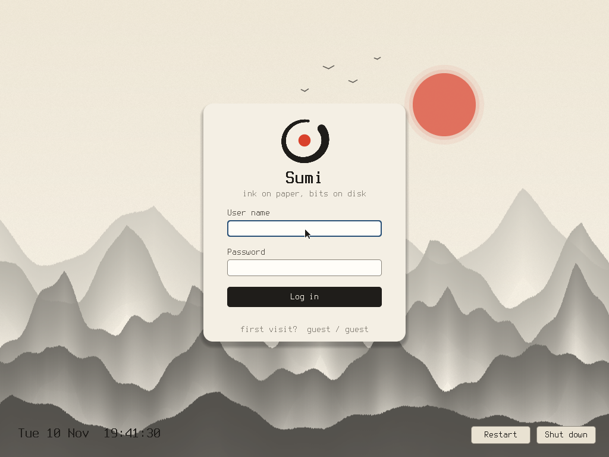
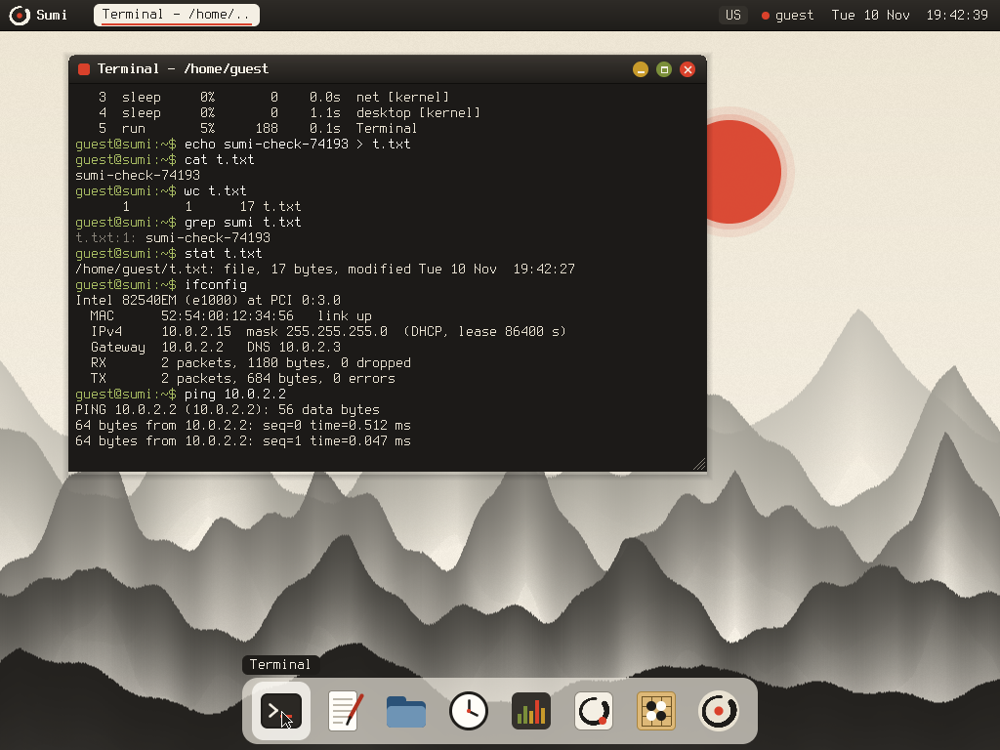

# Sumi OS — Claude Fable 5.2 がゼロから作った試作OS

YouTube「海外テックの『これマジ?』」の実演で使った成果物と記録です。

Anthropic が 2026年11月9日に公開した Claude Fable 5.2 に、空のフォルダーと課題文1通([prompts/os.txt](prompts/os.txt))だけを渡し、x86 PC(QEMU)で起動するデスクトップOSを作ってもらいました。名前・見た目・作業の分け方はモデルが決めています。




## 中身

| 場所 | 内容 |
|---|---|
| [sumi-os/](sumi-os/) | Fable 5.2 が書いたOSのソース一式(作業が止まった時点のまま。人は直していません)。説明書は [sumi-os/README.md](sumi-os/README.md) |
| [prompts/](prompts/) | 課題文と、利用上限で止まったあとに渡した再開メモ |
| [CONDITIONS.md](CONDITIONS.md) | 実行の条件 |
| [checks/](checks/) | 制作側が実行前に決めた検査項目と、QEMU を操作する検査用スクリプト |
| [RESULTS.md](RESULTS.md) | 実行の経過と検査結果 |
| [screenshots/](screenshots/) | 検査で撮った画面 |

## 動かし方

Linux で gcc(32ビット出力)、binutils、nasm、GRUB(grub-mkrescue)、xorriso、mtools、python3、QEMU、OVMF が必要です。

```
cd sumi-os
./build.sh
./run.sh              # ログインは guest / guest
```

詳しくは [sumi-os/README.md](sumi-os/README.md)(英語。モデルが書いたもの)。

## 要点

- 実行は Claude Code の1つのセッションを、利用上限による中断をはさんで3回(31分・20分・45分、計96分)。モデルは延べ12体のサブエージェントを起動しました。
- C と NASM で約9,400行。カーネル、割り込み、スケジューラー、ディスクとネットワークのドライバー、ファイルシステム、ウィンドウシステム、アプリ9つ、インストーラー。
- 完了の定義9項目は、制作側が QEMU で操作して確かめました([RESULTS.md](RESULTS.md))。
- モデルの完了報告はありません。
- コードは、モデルが書いたまま一切直していません。公開にあたって制作側が変えたのは2点だけです: sumi-os/README.md の通信の説明で未記入だった3か所を、sumi-os/kernel/net.c と apps/terminal.c の内容から補ったこと、作業用に残っていた apps/terminal.c.orig を外したこと。変更前の値は SHA256SUMS.txt に残しています。
- 公式発表の事例(1,000体超のサブエージェント、8日間)の再現ではありません。規模はずっと小さく、実行は1回だけです。

## フォント

sumi-os/ に同梱のフォントは Terminus Font(SIL Open Font License 1.1、[sumi-os/fonts/OFL-Terminus.txt](sumi-os/fonts/OFL-Terminus.txt))です。

---

**English summary.** Sumi OS is a prototype desktop operating system written by Claude Fable 5.2 (Claude Code, effort high) from an empty folder and a single prompt ([prompts/os.txt](prompts/os.txt)), in 96 minutes of work split over three sessions by account usage limits. About 9,400 lines of C and NASM: kernel, drivers, file system, window system, nine applications and an installer. The code is published exactly as the run left it; no code was changed by hand. For publication the producer only filled three unfinished places in the networking part of sumi-os/README.md from the source (kernel/net.c, apps/terminal.c) and removed a leftover apps/terminal.c.orig; SHA256SUMS.txt lists the files as the run left them. Checks made by the video's producer are in [RESULTS.md](RESULTS.md) (Japanese).
